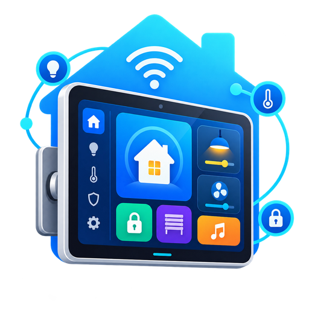
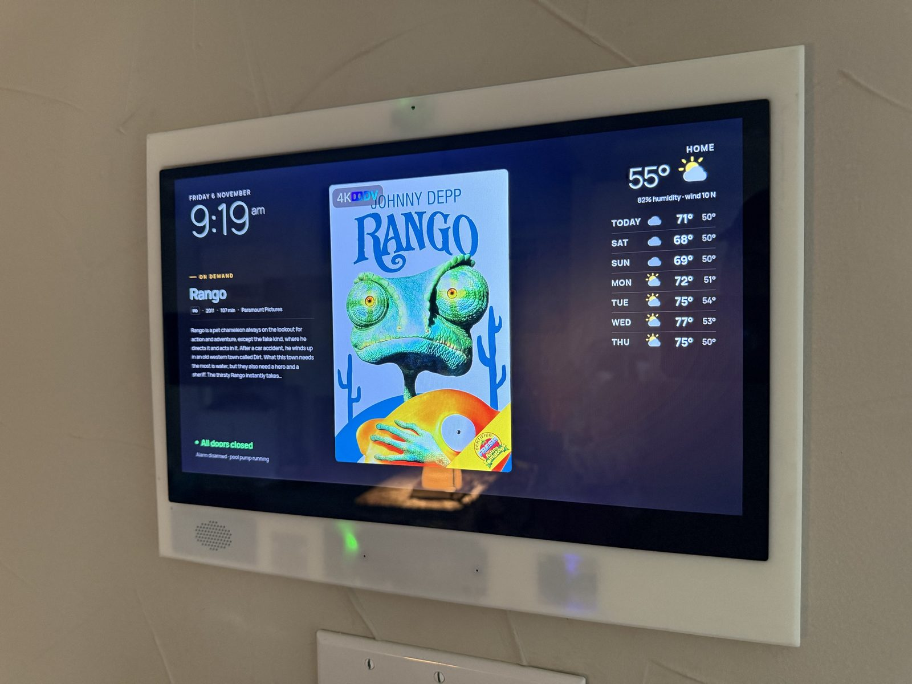
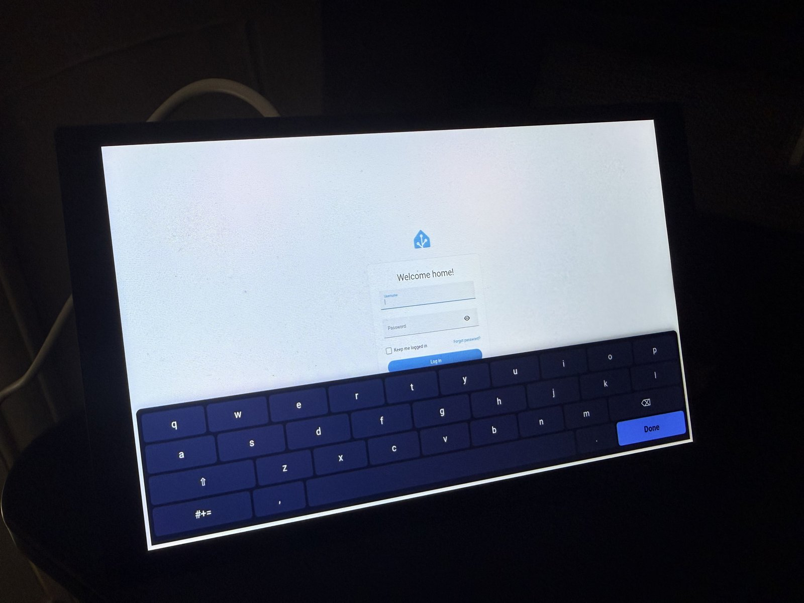
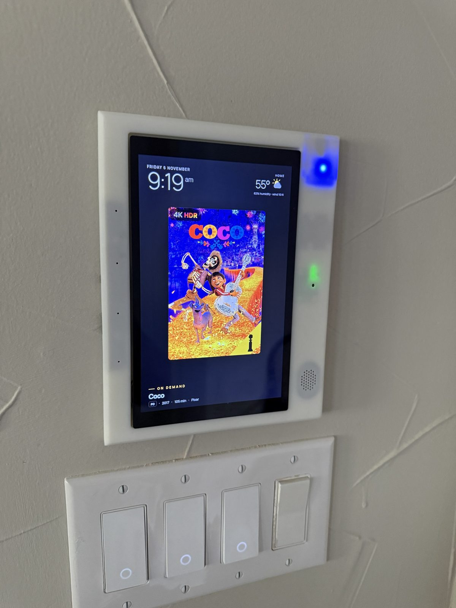

<p align="center"></p>

# Home Assistant Kiosk

A deployable Raspberry Pi image for a touchscreen Home Assistant dashboard kiosk. Flash it, boot it, walk through a first-boot setup wizard **on the screen itself** — no SSH, no keyboard/mouse (beyond the touchscreen) required — and it's running your dashboard. An optional companion [Home Assistant integration](#home-assistant-integration-hacs) turns every kiosk into real HA entities instead of hand-written MQTT YAML.

<p align="center"></p>

## Features

- Fullscreen Chromium kiosk pointed at any Home Assistant dashboard URL
- First-boot **setup wizard** (runs on the kiosk's own screen, with an on-screen keyboard) for device name, Wi-Fi, dashboard URL, screen orientation, MQTT broker, screensaver, and sensors
- **Animated boot splash** covering the entire boot sequence (kernel/console text is suppressed) — correctly centered and oriented for whichever rotation you configure, and scaled to fit your screen's actual resolution without stretching, whatever its aspect ratio
- Optional MQTT bridge services: brightness control, DPMS (screen on/off), screensaver control, reboot/refresh-on-command, temperature reporting, and live (no-reboot) control of dashboard URL / screensaver URL / screensaver timeout
- Optional sensor support: ambient light, mmWave presence (with distance), and radar presence — see [Optional sensors](#optional-sensors) below
- **[Home Assistant Kiosk Panel](custom_components/ha_kiosk_panel/)**, a companion HACS integration: auto-discovers kiosks over MQTT and exposes everything above as real entities — sensors, switches, buttons, an MPD media player, and live text/number controls for the dashboard and screensaver settings
- **Reconfigure without reflashing**: run `kiosk-reconfigure` over SSH/local terminal, or press "Rearm Setup Wizard" in the HA integration, to drop back into the setup wizard (pre-filled with current settings) and change anything
- Auto-negotiates your display's native resolution (no hardcoded video mode) and auto-detects the touchscreen device, so rotation and touch alignment work correctly regardless of which panel you use
- Wi-Fi watchdog (auto-recovers a dropped connection)
- Optional **wake-word listener** (openWakeWord on a ReSpeaker microphone) for a voice assistant dashboard, see [Voice wake word](#voice-wake-word-optional)
- Works with **Raspberry Pi cameras** for streaming to an NVR such as Frigate, see [Cameras](#cameras-optional). Setup is manual; the image doesn't configure a camera
- Auto-expands to fill whatever size SD card it's flashed to (the image itself ships shrunk down for a fast download)

## Screenshots

<table>
<tr>
<td width="50%"><br><sub>First-boot setup wizard, with its own on-screen keyboard</sub></td>
<td width="50%"><br><sub>Screensaver mode</sub></td>
</tr>
</table>

## Which Raspberry Pi models work

**Confirmed / primary target: Raspberry Pi 5.** This is what the image is built and tested against. If you're buying new hardware for this, get a Pi 5.

**Likely fine, not fully tested: Raspberry Pi 4B.** The kiosk itself (Chromium, the setup wizard, the MQTT bridge scripts, MPD) is plain Python/bash with nothing Pi-5-specific, and the I2C-based lux sensor should work unchanged. However, two of the optional sensor integrations *are* Pi 5-specific as documented:
- The C4001 mmWave sensor's UART is enabled via a `uart1-pi5`-named `dtoverlay` in `cmdline.txt` — Pi 4 uses different overlay names (`uart2`/`uart3`/etc.), so this would need adjusting.
- The RCWL-0516 wiring in [HARDWARE.md](HARDWARE.md) references a GPIO-chip line-offset quirk specific to the Pi 5's RP1 southbridge — on a Pi 4 the line offset equals the BCM number directly, no lookup needed, but the script's hardcoded offset would need updating.

If you're on a Pi 4 and stick to the display + lux sensor (skip C4001/RCWL, or wire them up and adjust those two things yourself), it should work fine.

**Not recommended: Pi 3B/3B+, Pi Zero 2 W, or older.** Untested, and Chromium running a live dashboard plus MPD plus sensor polling is a real workload — expect it to struggle even if it technically boots.

## Hardware you'll need

- **A Raspberry Pi 5** (4GB or 8GB) and its **official 27W USB-C power supply**. Don't skimp on the power supply — an underpowered or non-PD supply causes real, hard-to-diagnose problems (this project's own hardware testing found a touchscreen intermittently brownout-disconnecting from USB purely due to insufficient power).
- **A microSD card**, 16GB minimum, 32GB+ recommended (the image auto-expands to fill whatever you use).
- **A touchscreen display.** Any HDMI display works for the dashboard itself (resolution is auto-negotiated, no hardcoding); for touch input you'll want a USB or DSI capacitive touchscreen. Two concrete options this project has direct experience with:
  - **[Waveshare 8DP-CAPLCD](https://www.waveshare.com/8dp-caplcd.htm)** — 8", 1280×800, HDMI + USB touch. This is what the current hardware testing was done against. Needs a solid 5V/3A+ power source for the panel itself, separate from the Pi's own supply — this is the exact panel that suffered the USB brownout issue mentioned above when underpowered.
  - **[Waveshare 15.6" HDMI LCD (H)](https://www.waveshare.com/15.6inch-hdmi-lcd.htm)** — 15.6", 1920×1080, HDMI + USB touch, wants its own 12V power adapter.
  - Waveshare also makes 10.1" and other in-between sizes if you want something different — any of them should work the same way (auto-negotiated resolution, no per-model config needed) as long as it's HDMI + USB (or DSI) capacitive touch.
- **Optional sensors** — see below.
- **Optional microphone and speaker**: a Seeed ReSpeaker Lite (USB) or ReSpeaker Flex XVF3800 (USB), for the [wake word](#voice-wake-word-optional).
- **Optional camera** — see [Cameras](#cameras-optional).
- **Optional wall frame**: 3D-printable frames for the 8" and 15.6" displays are in [hardware/enclosure/](hardware/enclosure/).

### Optional sensors

Each is independently toggled in the setup wizard, and each just needs an MQTT broker to report to — no hardware sensor is required for the kiosk to work.

| Sensor | What it adds | Interface |
|---|---|---|
| VEML7700 (recommended) or BH1750 ambient light | Lux reading, for lux-based brightness automations | I2C |
| C4001 mmWave presence | Presence + distance | UART (Pi 5 only as shipped — see above) |
| RCWL-0516 radar presence | Presence (on/off only, no distance) | GPIO (Pi 5 line-offset as shipped — see above) |

Full wiring diagrams, physical pin numbers, and the exact `config.txt` overlays each one needs are in **[HARDWARE.md](HARDWARE.md)** — read that before wiring anything up, wrong pins can damage hardware.

## Cameras (optional)

A Pi 5 has two camera connectors (CAM/DISP 0 and 1) and runs two cameras at once. The image doesn't set this up, so add it by hand after first boot. Tested on a Pi 5 with a Raspberry Pi Camera Module V2 and an Arducam IMX219 wide-angle module (board marked `V2.3`, `UC-609 Rev.E`).

**Cable:** the Pi 5 uses the narrow 22-pin connector, so a standard 15-pin camera needs a 22-to-15-pin camera cable. Display cables look similar but aren't interchangeable. Power the Pi off before moving a cable.

**Modules without an EEPROM aren't auto-detected.** Official cameras are found by `camera_auto_detect=1`. Some third-party IMX219 boards aren't, so name the driver for each port in `/boot/firmware/config.txt` and reboot:

```ini
camera_auto_detect=0

[all]
dtoverlay=imx219,cam0
dtoverlay=imx219
```

`cam0` is CAM/DISP 0, and leaving it off means CAM/DISP 1. Check with `rpicam-hello --list-cameras`.

**`failed to read chip id` / error -121** in `dmesg` means the driver loaded but nothing answered, so check the hardware first. Try the cable flipped: on one third-party module, the orientation that looked right in photos was wrong, and reversing it fixed the error. Swapping two cameras between ports shows whether the fault follows the camera or stays with the port.

**Don't use 1920x1080 on an IMX219 if you want the whole view.** That mode is a crop from the center of the sensor. 1640x1232 uses the full sensor.

**Pink or magenta edges on a wide lens:** the stock `imx219.json` tuning corrects color shading for the standard lens. Copy `/usr/share/libcamera/ipa/rpi/pisp/imx219.json`, and under `rpi.alsc` set `calibrations_Cr` and `calibrations_Cb` to one flat table of 1,024 values of `1.0`, for example `[{"ct": 3000, "table": [1.0, ...]}]`. Pass the copy with `--tuning-file`. Tuning files apply per application, so a second camera can keep the stock file. This is a quick fix, not a full lens calibration.

**Streaming:** use [MediaMTX](https://github.com/bluenviron/mediamtx). It gives each camera an RTSP address for an NVR and a browser page over WebRTC. A plain `rpicam-vid --listen` stream froze in VLC in testing, with out-of-order timestamps and gaps of over a second. The Pi 5 has no hardware H.264 encoder, so select the software one:

```yaml
rtmp: no
hls: no
srt: no
paths:
  cam0:
    source: rpiCamera
    rpiCameraCamID: 0
    rpiCameraWidth: 1640
    rpiCameraHeight: 1232
    rpiCameraFPS: 15
    rpiCameraBitrate: 4000000
    rpiCameraIDRPeriod: 30
    rpiCameraCodec: softwareH264
    # rpiCameraTuningFile: /home/kiosk/your-tuning.json
```

Then open `http://<kiosk>:8889/cam0` in a browser, or `rtsp://<kiosk>:8554/cam0` in an NVR. **This config has no password**, so anyone on your network can watch. Add MediaMTX authentication if that matters.

**Load on one Pi 5** (8 GB, on an open bench, panel running but not animating, over Wi-Fi):

| Stream | Total CPU | Peak temperature |
|---|---|---|
| None | 2.7% | 41.7 °C |
| One camera, 1080p, 5 fps, software H.264 | 7.2% | 43.3 °C |
| One camera, 1080p, 15 fps | 14.2% (15.5% over 10 minutes) | 51.0 °C over 10 minutes |
| One camera, 1080p, 30 fps | 25.1% (87% of one core) | 49.9 °C |
| Two cameras, 1640x1232, 15 fps, MediaMTX | About 26% | 48.3 °C |

All of these delivered their full frame rate with no throttling. They were short bench runs, and a closed wall mount will run hotter. Expect more GPU use from an animated dashboard.

## Voice wake word (optional)

`tars-wake.service` runs [`tars_wake.py`](build/scripts/tars_wake.py), which listens on the microphone with [openWakeWord](https://github.com/dscripka/openWakeWord) and tells the dashboard when it hears the wake word. It's written for the author's own dashboard, so **it isn't a complete assistant and isn't set up by the image**. To use it you need:

- your own wake-word models in `~/tars-wake/models/` (`.onnx`, none are included here), plus openWakeWord's `melspectrogram.onnx` and `embedding_model.onnx`
- a Python environment in `~/tars-wake/.venv` with onnxruntime, numpy, scipy, scikit-learn, requests and openwakeword 0.6.0 (`--no-deps`)
- an ALSA device named `tars_mic` in `~/.asoundrc`, shared with `dsnoop` so the dashboard can open the microphone too (below, for a ReSpeaker Lite)
- a dashboard that answers `POST <panel>/api/tars/wake`, or your own changes to the script

```
pcm.respeaker_snoop {
    type dsnoop
    ipc_key 5163
    ipc_perm 0666
    slave { pcm "hw:CARD=Lite,DEV=0"; channels 2; rate 16000; format S16_LE; period_size 256; buffer_size 4096 }
}
pcm.tars_mic {
    type plug
    slave { pcm "respeaker_snoop"; channels 2 }
    ttable.0.0 1
}
```

**Privacy:** the listener keeps the 2.56 seconds of audio that triggered each wake on the kiosk, in `~/tars-wake/clips` (newest 400), for retraining. It's not uploaded by the script, but anyone with access to the kiosk can read those clips.

## Step-by-step setup

### 1. Flash the image

1. Download `ha-kiosk-generic.img.xz` from this repo's [Releases](../../releases) page.
2. Flash it to your microSD card with [Raspberry Pi Imager](https://www.raspberrypi.com/software/) (**Choose OS → Use custom**, point it at the downloaded file) — this is the recommended tool; it verifies the write and handles `.xz` decompression automatically. Rufus and Win32DiskImager also work if you'd rather use something lighter than Etcher.
3. Insert the card into the Pi, connect your display (and touchscreen, if using one) and power, and boot.

### 2. Set it up: from your computer, or on the screen

**Option A: the web setup wizard (no keyboard or touch needed).** Open the
[**Kiosk Setup Wizard**](https://payton1394.github.io/home-assistant-kiosk/wizard/) on any computer or phone, fill in the same
settings as below, and download `kiosk-setup.json`. After flashing, re-insert the card, copy the file onto the `bootfs`
drive, eject and boot. On first boot the kiosk applies it (Wi-Fi, dashboard, MQTT, sensors, rotation, SSH key, password),
deletes the file (it holds your passwords) and starts the dashboard. A `kiosk-setup-result.txt` without passwords is left on
`bootfs` saying what was applied, or what went wrong (then the file stays and the on-screen wizard still opens).
The page runs entirely in your browser; nothing you type is sent anywhere. Dropping a new `kiosk-setup.json` on the card later
re-configures the kiosk the same way. Needs an image from v1.1.0 on.

**Option B: the on-screen setup wizard.** Boot without a setup file and the wizard appears automatically on first boot — no SSH, no external keyboard/mouse needed, it has its own on-screen keyboard. It's eight steps, the last two collapsed by default:

1. **Device** — a name (e.g. "Kitchen"). This becomes the hostname and the MQTT topic prefix (`kiosk/kitchen`).
2. **Wi-Fi** — scans nearby networks, or check "already connected" if you're on Ethernet.
3. **Dashboard** — the URL of the Home Assistant dashboard you want shown fullscreen.
4. **Screen orientation** — normal/right/left/inverted; handles display rotation, touch alignment, console, and the boot splash together.
5. **Screensaver** *(optional)* — tick **Use the built-in screensaver** to get xscreensaver showing a URL when idle (e.g. a photo slideshow server). The image ships without xscreensaver; ticking this installs it (needs internet). Leave it unticked if your dashboard has its own screensaver: nothing of xscreensaver is installed, and the screen still turns off after the timeout set under Advanced.
6. **MQTT & smart features** *(optional — leave the broker field blank to run as a plain browser kiosk)* — broker host/port/credentials, plus checkboxes for whichever optional sensors you've actually wired up (see [Optional sensors](#optional-sensors)).
7. **Remote access** — set a real SSH/terminal password (the image ships with a documented default, `ChangeMe-Kiosk1!` for user `kiosk`, worth changing before this touches a network you care about) and/or paste an SSH public key for passwordless access.
8. **Advanced** *(optional)* — touch input device override (auto-detected normally, only needed if that fails), brightness min/max, screensaver/screen-off timeouts.

Save, and the Pi reboots straight into your dashboard.

### 3. (Optional) Install the Home Assistant integration

If you enabled MQTT in step 6, add the companion integration so every kiosk shows up as real entities in HA instead of raw MQTT topics:

1. In HACS: **⋮ → Custom repositories**, add this repo's URL as an **Integration**. (Once this repo is accepted into the default HACS store, this manual step won't be needed.)
2. Install **Home Assistant Kiosk Panel**, restart Home Assistant.
3. Within about a minute, HA will show a **"Kiosk Panel discovered"** notification for each kiosk on your network with MQTT enabled — confirm it (optionally correcting the auto-detected IP).

See the [integration's own README](custom_components/ha_kiosk_panel/README.md) for the full entity list and requirements.

### 4. Changing settings later

No need to reflash for any of this:

- **Any setting**: SSH in (if you added a key) or use a local terminal and run `kiosk-reconfigure` — drops you back into the same wizard, pre-filled with current settings, on next reboot. Or press **Rearm Setup Wizard** in the HA integration to do the same thing without SSH at all.
- **Dashboard URL, screensaver URL, or screensaver timeout specifically**: change these live, no reboot, via the integration's text/number entities, or by publishing to the kiosk's `dashboard_url/set` / `screensaver_url/set` / `screensaver_timeout/set` MQTT topics directly.

## Configuration reference

The wizard writes everything to `~/kiosk_config.ini` on the kiosk (`build/kiosk_config.ini.example` in this repo is the generic template it starts from). You generally shouldn't need to hand-edit this — the wizard covers every field — but for reference:

| Section | Key | Meaning |
|---|---|---|
| `[mqtt]` | `host`, `port`, `username`, `password` | Broker connection. Blank host = MQTT disabled entirely. |
| `[mqtt]` | `base_topic` | MQTT topic prefix, e.g. `kiosk/kitchen`. Auto-derived from the device name. |
| `[kiosk]` | `url` | The dashboard URL shown fullscreen. |
| `[kiosk]` | `panel_name` | Slugified device name (hostname, MQTT topic). |
| `[kiosk]` | `brightness_min` / `brightness_max` | Clamp range for the brightness MQTT control (uses `ddcutil`, requires a DDC/CI-capable monitor). |
| `[screensaver]` | `url` | Screensaver page URL; blank disables it. |
| `[screensaver]` | `timeout_seconds` / `dpms_off_seconds` | Idle time before screensaver / before the display powers off by itself (0, the default, = never: Home Assistant switches it over MQTT). |
| `[c4001]` | `uart_device`, `baud`, `hold_seconds` | mmWave sensor UART settings and presence hold time. |
| `[display]` | `rotation` | `normal` / `right` / `left` / `inverted`. |
| `[display]` | `touch_device` | Touch input override; leave blank for auto-detection. |
| `[tars_wake]` | `pcm`, `hey_tars`, `tars`, `cooldown`, `models`, `backup` | Optional wake-word settings: microphone device, detection thresholds (0.5 for `hey_tars`, 0.6 for `tars` by default), seconds between wakes, model folder, and a backup server address. Set `backup` to your own server. |

MQTT topics for live control (dashboard URL, screensaver URL/timeout, refresh, reboot, rearm-wizard, identity/availability) are fixed rather than ini-configurable — see the comment block in `build/kiosk_config.ini.example` or the [integration README](custom_components/ha_kiosk_panel/README.md)'s entity table for the exact topic names.

## What's inside

Not a Home Assistant install — this is a kiosk *client* (Chromium fullscreen) plus a set of small, single-purpose systemd services that expose the physical display and any attached sensors as MQTT topics, so Home Assistant (or anything else) can read/control them. Every one of these is tracked source in this repo (`build/scripts/` + `build/systemd/`), not just something that happened to exist on a device's disk — the image-build tooling installs each one explicitly.

| Service | Always on? | What it does |
|---|---|---|
| `kiosk.service` | Yes | Starts X + Chromium fullscreen (`kiosk.sh` via `startx`). The core of the kiosk. |
| `wifi-watchdog.service` | Yes | Pings out every 30s; if it fails, bounces the `wlan0` interface down/up. |
| `kiosk-net-watchdog.timer` → `.service` | Yes (every 1 min) | After 2 consecutive failed gateway pings, restarts `NetworkManager` (cooldown-limited). A different, complementary recovery path from the watchdog above — this one targets a stuck NetworkManager/association rather than the interface itself. |
| `kiosk-net-logger.timer` → `.service` | Yes (every 2 min) | Appends a network/throttle diagnostic snapshot to `~/kiosk-net.log` whenever a gateway ping fails or the Pi's throttle status changes — for after-the-fact debugging, not corrective action. |
| `kiosk-config-mqtt.service` | If MQTT configured | Dashboard/screensaver URL + screensaver timeout as MQTT command/state topics, plus the identity/availability payload the HA integration's auto-discovery relies on. See [kiosk_config_mqtt.py](build/scripts/kiosk_config_mqtt.py). |
| `kiosk-screensaver-mqtt.service` | If MQTT configured and the built-in screensaver is on | Screensaver on/off via MQTT, backed by `xscreensaver-command`. |
| `kiosk-dpms-mqtt.service` | If MQTT configured | Display power on/off via MQTT, backed by `xset dpms`. |
| `kiosk_brightness_mqtt.service` | If MQTT configured | Backlight brightness via MQTT, backed by `ddcutil` (requires a DDC/CI-capable monitor). |
| `kiosk-reboot-mqtt.service` | If MQTT configured | Reboots the Pi on an MQTT command. |
| `rpi-temp-mqtt.service` | If MQTT configured | Publishes CPU temperature every 30s (`vcgencmd measure_temp`). |
| `kiosk-lux-mqtt.service` | If lux sensor enabled | Ambient light level from a VEML7700 or BH1750 sensor over I2C (whichever is fitted). |
| `c4001_presence.service` | If C4001 sensor enabled | Presence (and, depending on sensor mode, distance) from a DFRobot C4001 mmWave sensor over UART. Manual tuning tools live in [build/scripts/c4001-tools/](build/scripts/c4001-tools/). |
| `rcwl-presence.service` | If RCWL sensor enabled | Presence from an RCWL-0516 microwave radar sensor over GPIO. |
| `tars-wake.service` | Manual setup only | Wake-word listener. See [Voice wake word](#voice-wake-word-optional). |

The "if MQTT/sensor configured" ones are installed disabled by default — the setup wizard enables exactly the ones a given kiosk needs based on what you fill in.

## Home Assistant integration (HACS)

`custom_components/ha_kiosk_panel/` is a companion integration that turns each kiosk's MQTT topics into real entities instead of hand-written MQTT YAML. See [Step 3](#3-optional-install-the-home-assistant-integration) above for installation, and the [integration's own README](custom_components/ha_kiosk_panel/README.md) for the full entity list and MQTT topic contract.

## Repository layout

```
build/
  kiosk_config.ini.example - generic config template (wizard fills this in)
  setup_wizard/             - the first-boot wizard (Python stdlib server + HTML/CSS/JS)
  scripts/kiosk-import-setup.py + systemd/kiosk-import-setup.service - applies kiosk-setup.json from bootfs on boot
  scripts/kiosk-install-xscreensaver.sh - installs xscreensaver on demand (opt-in; not shipped in the image)
  scripts/kiosk-set-hostname.sh - sets a hostname that survives reboots (also updates cloud-init's user-data and /etc/hosts)
  home/xinitrc              - the kiosk user's X session (~/.xinitrc): starts xscreensaver only when opted in
  keyboard_extension/       - Chromium extension: on-screen keyboard on every page (wizard + dashboard)
  systemd/                  - every unit file installed on the kiosk (see the service table above)
  scripts/                  - every script those units run (MQTT bridges, watchdogs, wizard support, splash);
                              c4001-tools/ holds manual sensor tuning/debug utilities (not run automatically)
  assets/                   - source logo + spinner animation the boot splash is built from
  sudoers.d/                - narrowly-scoped passwordless sudo for the wizard and the config MQTT bridge
custom_components/
  ha_kiosk_panel/           - companion HACS integration (see above)
docs/wizard/                - the web setup wizard (GitHub Pages), makes kiosk-setup.json in the browser
docs/images/                - screenshots and logo used in this README
hardware/enclosure/         - 3D-printable wall frames and clamps (STL)
HARDWARE.md                 - optional sensor wiring/pinouts (lux, C4001, RCWL-0516)
README.md                   - this file
```

## Security notes

- **Default login**: the `kiosk` user ships with the password `ChangeMe-Kiosk1!` for local terminal/SSH access — set your own during first-boot setup (wizard step 7, "Remote access") or later via `kiosk-reconfigure`. Change this before the device touches any network you care about.
- No SSH keys, Wi-Fi passwords, or MQTT credentials are baked into the image — everything is entered fresh through the wizard on first boot.
- The wizard's local HTTP server binds to `127.0.0.1` only; it's reachable exclusively from the kiosk's own Chromium on the kiosk's own screen, never over the network.
- Chromium starts with `--use-fake-ui-for-media-stream` and `--autoplay-policy=no-user-gesture-required`, so the dashboard can use the microphone (intercom, voice) and play sounds (doorbell chimes) without anyone tapping the screen. The kiosk only opens the dashboard URL you configure, but any page it shows gets the same rights: point it only at your own Home Assistant.
- Camera streams and wake-word clips are private data, and neither is on by default. See [Cameras](#cameras-optional) and [Voice wake word](#voice-wake-word-optional).
- SSH access is opt-in: paste a public key into the wizard's "Remote access" section, or manage `~/.ssh/authorized_keys` yourself.
- The `kiosk` user has a narrowly-scoped `sudoers.d` rule (Wi-Fi, hostname, specific systemd units, reboot, changing the terminal password) rather than blanket sudo — see `build/sudoers.d/kiosk-wizard` for the exact rule and rationale.

## Known issues

- **The source here can be ahead of the latest release image.** Check the release notes. Features added after a release need a newer image or a manual install.
- **Wi-Fi on Pi 5 with Raspberry Pi OS trixie.** With NetworkManager's default wpa_supplicant backend, Wi-Fi dropped at random and sometimes needed a reboot. Using iwd fixed it: `apt install iwd`, then `/etc/NetworkManager/conf.d/wifi-backend.conf` with `[device]` and `wifi.backend=iwd`. iwd keeps saved networks separately in `/var/lib/iwd/`, so a cloned SD card keeps the old Wi-Fi unless that folder is wiped too.
- **Wi-Fi power saving.** With iwd, NetworkManager's `wifi.powersave` setting is ignored. To turn it off on the Pi's radio, add this to `/etc/iwd/main.conf`:

  ```ini
  [DriverQuirks]
  PowerSaveDisable=brcmfmac
  ```
- **Wake word detection on a TV.** Audio from a TV can score as high as a real wake word, so a nearby TV can set it off.
- **Wake word stops detecting (cause not found).** One kiosk stopped detecting for about 20 hours, including across a reboot, while the service and microphone looked healthy. Restarting `tars-wake` and the browser cleared it.

## Future ideas

### Remote/OTA updates for already-deployed kiosks

Not implemented. Notes for whoever picks this up:

**Why it's not just "flash over SSH"**: a kiosk is booted from and actively running on the same SD card you'd be updating - `dd`-ing a new image onto that disk out from under the live, mounted root filesystem corrupts it. A true A/B partition scheme (two root partitions, update writes to the inactive one, bootloader flag flips on next boot, rollback if it fails) would sidestep that, but it's a genuine re-architecture - partition layout, boot flow, updater tooling - not a small addition, and probably overkill for how this project actually changes over time.

**Current direction**: skip full image-level OTA. Instead, ship each feature update as a downloadable package (e.g. a GitHub release tarball) that a user SSHes in and applies via an `apply-update` style script - the script drops in whatever new/changed scripts and systemd service units the release needs (same pattern as `kiosk-reconfigure` already uses for dropping back into the wizard, just generalized to "install these files, enable these units, restart these services"). Manual-but-scripted, not automatic - the user still initiates it, but doesn't need to hand-copy files or remember what changed.

Two pieces that pattern needs:
- **A defined package format** - versioned bundle (files + a manifest listing what changes: new/updated scripts, new systemd units to enable, services to restart) and the `apply-update` script that reads that manifest and applies it idempotently. Should be safe to re-run and should touch only its own known-managed files, never user config - kiosks drift from the shipped baseline over time (wizard-entered config, ad-hoc live SSH patches) and an updater must not stomp on that.
- **Version visibility from Home Assistant, no SSH required** - already built: `kiosk_config_mqtt.py` publishes a `sw_version` field in its `panel/state` identity payload, and the integration's **Software Version** sensor surfaces it - so a future update-package mechanism already has a version-tracking anchor to report against.
